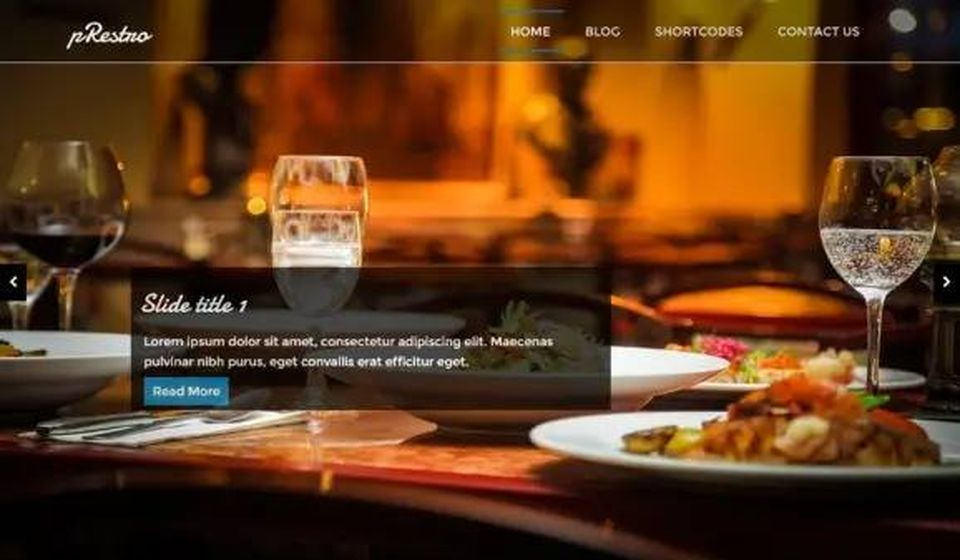
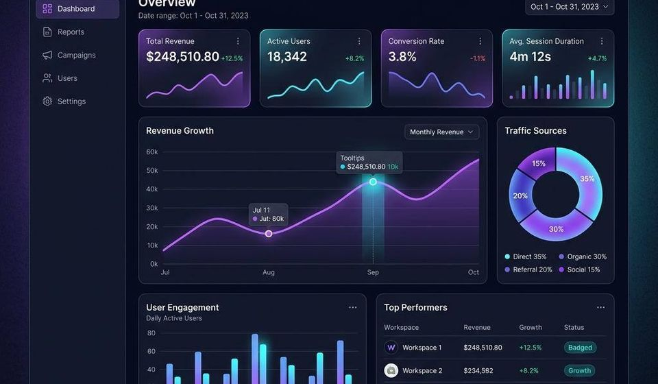
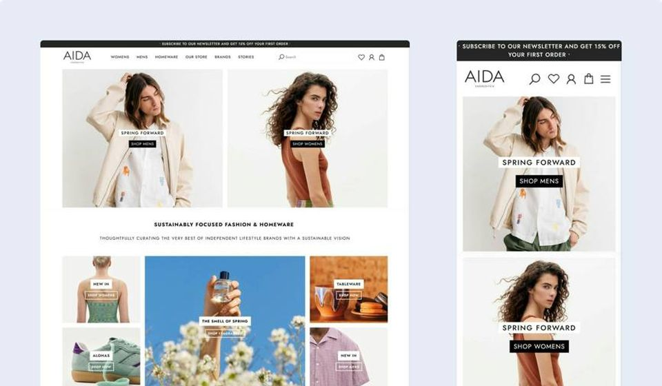
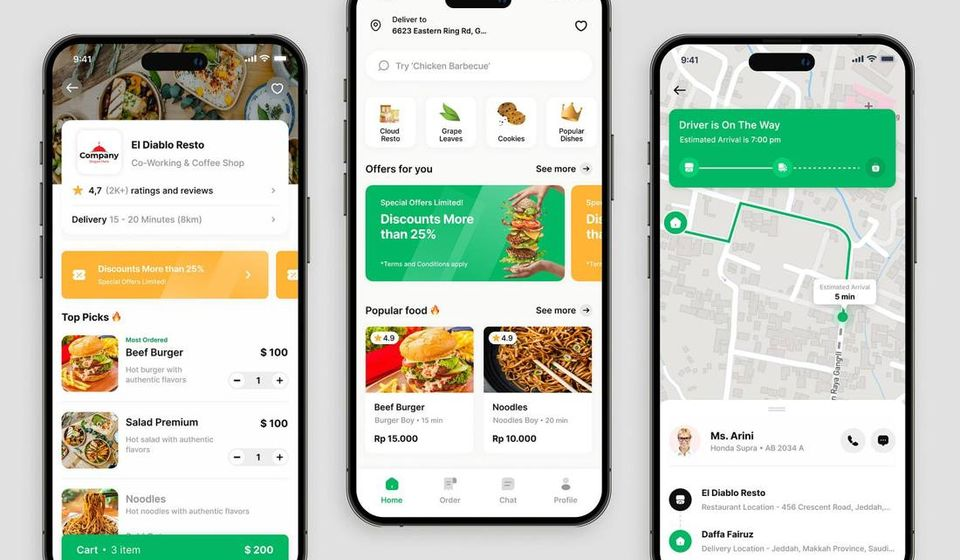
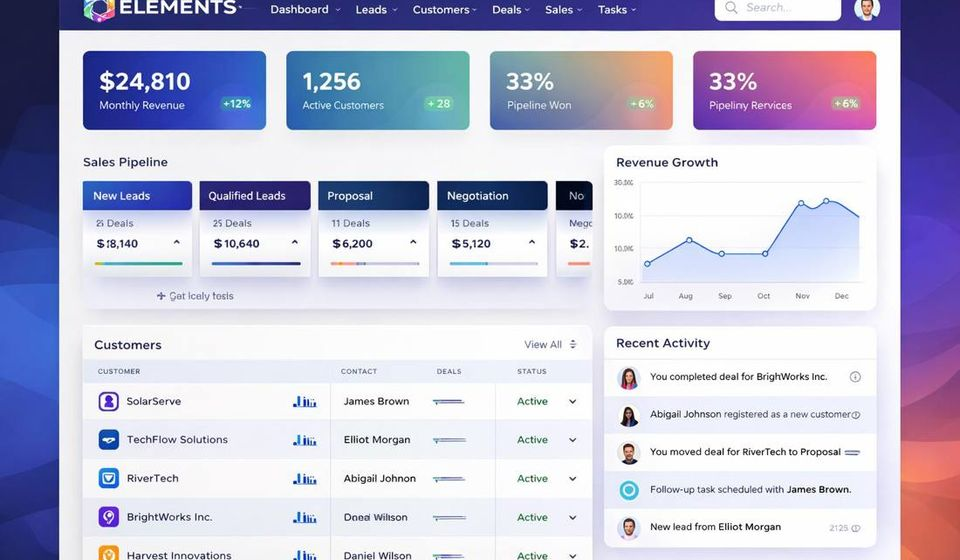
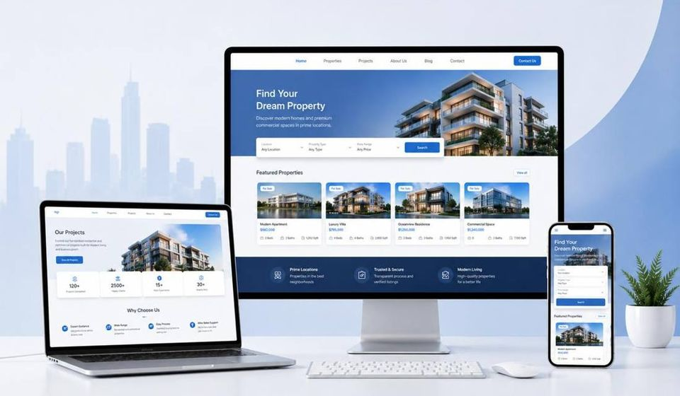

<h1 align="center">Anderson T. M. L.</h1>

  <strong>Senior Full Stack &amp; Android Developer</strong> · Brazil 
  <a href="mailto:raymond.r0427@gmail.com">Email</a> ·
  <a href="https://github.com/Anderson10213">GitHub</a> ·
  <a href="https://www.workana.com/freelancer/df0b163e934eb86741879c330928cd44">Recent client work</a>

  
  
  
  

More than a decade building interfaces, and many years shipping full products: web platforms, Android apps, and cloud systems for startups, small companies, and larger businesses. The work below comes from that practice. Recent freelance delivery sits alongside the systems built before it. Portuguese and English. Clean architecture, from concept to production.

## Selected work

<table>
<tr>
<td width="33%" valign="top"> <b>pRestro</b> Restaurant theme  </td>
<td width="33%" valign="top"> <b>NexaCore</b> AI SaaS analytics  </td>
<td width="33%" valign="top"> <b>AIDA</b> Shopify store  </td>
</tr>
<tr>
<td width="33%" valign="top"> <b>Food delivery</b> Menu, offers, live tracking  </td>
<td width="33%" valign="top"> <b>ELEMENTS</b> CRM and sales pipeline  </td>
<td width="33%" valign="top"> <b>Real estate</b> Desktop, laptop, and phone  </td>
</tr>
</table>

## Skills

Responsive web, JavaScript, HTML, and CSS: 10+ years. React: 5–10 years. Python: 3–5 years.

<table>
<tr>
<td align="center"></td>
<td align="center"></td>
<td align="center"></td>
<td align="center"></td>
<td align="center"></td>
</tr>
<tr>
<td align="center"></td>
<td align="center"></td>
<td align="center"></td>
<td align="center"></td>
<td align="center"></td>
</tr>
<tr>
<td align="center"></td>
<td align="center"></td>
<td align="center"></td>
<td align="center"></td>
<td align="center"></td>
</tr>
<tr>
<td align="center"></td>
<td align="center"></td>
<td align="center"></td>
<td align="center"></td>
<td align="center"></td>
</tr>
</table>

**96%** Android advanced · **93%** CSS · **83%** Android intermediate · **80%** WordPress · **80%** English

## Selected notes

> Site rápido, seguro (LGPD) e otimizado para o Google Ads, com o tom certo para um consultório de psicologia. — **L. C. G. D. O.**

> Prestativo, inteligente e faz um bom trabalho. — **Amanda I.**, SaaS de obras com IA
